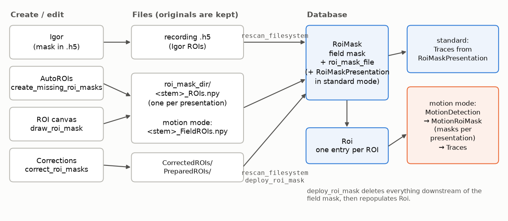
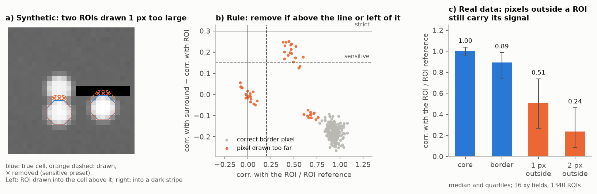
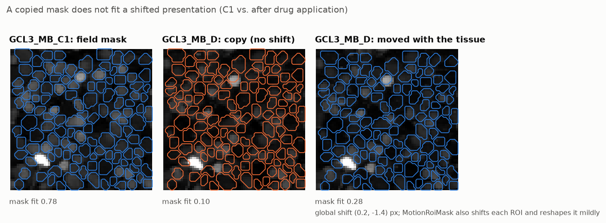
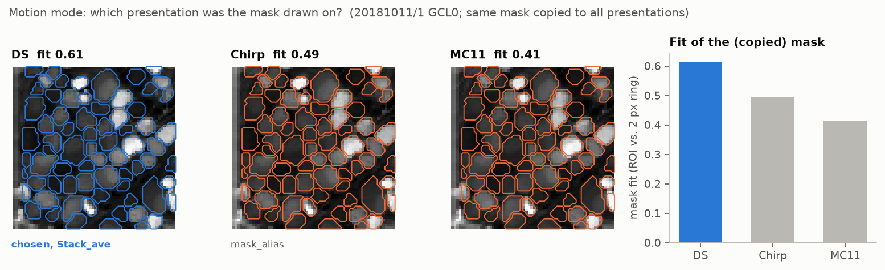

# ROI masks in djimaging

How ROI masks get into the database, how to create, check and correct them, and what changes in **motion mode**.
Installation and project setup: [README.md](README.md). The populate notebook of your project (`populate_<project>_schema.ipynb`, generated by `make_project.py`) contains
the cells for all steps below. Method details of motion mode: [docs/motion_qc.md](docs/motion_qc.md).

## Contents

1. [Basics](#1-basics)
2. [Mask files and settings](#2-mask-files-and-settings)
3. [Loading existing masks](#3-loading-existing-masks)
4. [Creating masks with AutoROIs (no GUI)](#4-creating-masks-with-autorois-no-gui)
5. [The ROI canvas](#5-the-roi-canvas)
6. [Correcting masks without GUI](#6-correcting-masks-without-gui)
7. [Shrink to fit](#7-shrink-to-fit)
8. [Replacing a mask in the database](#8-replacing-a-mask-in-the-database)
9. [Motion mode](#9-motion-mode)
10. [Recipes](#10-recipes)
11. [Troubleshooting](#11-troubleshooting)

## 1. Basics

- **`RoiMask`** holds the ROI mask of a field: which pixels belong to which ROI. One entry per field (and
  `RawDataParams`), together with the presentation the mask belongs to and the file it was loaded from.
- **`RoiMask.RoiMaskPresentation`** (standard mode only) holds the mask of every presentation of the field and how it
  relates to the field mask: `same`, `shifted` (by `shift_dx`, `shift_dy`) or `different`.
- **`Roi`** has one entry per ROI of the field mask. ROI ids are the mask labels, so changing labels or removing ROIs
  changes `Roi` and everything downstream.

**A mask always comes from a file.** `RoiMask` is a manual table; masks are never computed inside the database. You
create or edit a mask (Igor, AutoROIs, ROI canvas, correction functions), it is saved to a file, and the table reads
that file. Each entry stores `roi_mask_file` (path relative to the `reference` store) and `roi_mask_source` (`igor_h5`,
`numpy`, `pickle` or `other`). Functions that change masks write **new files into a separate directory** and keep
the original files.



*Masks are created or edited outside the database and saved to files; `rescan_filesystem` (new fields) or
`deploy_roi_mask` (replace a field) load them into `RoiMask`. In motion mode the presentation masks are computed by
`MotionRoiMask` instead of being read from files.*

**Standard mode vs. motion mode.** A schema is in motion mode if it was generated with the `motion` block
(`make_project.py <project> --blocks motion,...`). Then `RoiMask` only stores the field mask, the masks of the
presentations are computed by `MotionRoiMask` (per-ROI shifts between presentations, mild reshaping), and traces are
motion corrected. Sections 1-8 apply to both modes, with the motion-mode differences marked; section 9 describes motion
mode.

## 2. Mask files and settings

### Label formats

| Format | Background | ROIs | Used in |
|---|---|---|---|
| Igor | `1` | negative labels `-1, -2, ...` | the database (`roi_mask`), Igor `.h5` files |
| Python | `0` | positive labels `1, 2, ...` | mask files, ROI canvas, `mask_utils` functions |

Convert with `djimaging.utils.mask_format_utils.to_igor_format` / `to_python_format`.

### File types and names

Mask files live **next to the recording files**, in a sub-directory `roi_mask_dir` of the recording's parent folder
(e.g. `.../20220215/1/AutoROIs/` for `.../20220215/1/Pre/SMP_M1_GCL0_chirp_C1.h5`).

| File | Content | Written by |
|---|---|---|
| `<stem>_ROIs.npy` | mask of one presentation (`_roi_file_format='numpy'`, recommended) | canvas, `create_missing_roi_masks`, `correct_roi_masks` (standard mode) |
| `<stem>_ROIs.pkl` | the same as pickle (`_roi_file_format='pickle'`, for older masks) | as above |
| `<stem>_FieldROIs.npy` | **motion mode:** the one mask of a field, named after the presentation it belongs to | canvas, `correct_roi_masks`, `export_field_roi_masks` (motion mode) |
| `.h5` recording file | Igor mask (`ROIs`), drawn in Igor | Igor |

`<stem>` is the recording file name without extension. Field mask files are never read as presentation masks, so a
schema without motion mode ignores them.

Common directory names (only conventions): `ROIs`, `AutoROIs` (proposals), `CorrectedROIs` (`correct_roi_masks`),
`PreparedROIs` (`export_field_roi_masks`). Use one directory per source, so originals are never overwritten.

### Settings

| Setting | Where | Meaning |
|---|---|---|
| `_roi_file_format` | class attribute of `RoiMask` | `'numpy'` or `'pickle'` for presentation mask files |
| `igor_roi_masks` | `RawDataParams` | `'yes'`: masks from the Igor `.h5` files. `'no'`: from mask files only. `'either'`: per field, mask files if there are any, else Igor. `'init'`: the database is filled from mask files, Igor masks only serve as starting mask in the canvas. |
| `mask_alias`, `highres_alias` | `UserInfo` | order of preference of the presentations (underscore-separated name parts, e.g. `'chirp_mb_movingbar'`). In standard mode the first matching presentation with a mask holds the field mask. |
| `_max_shift` | class attribute of `RoiMask` (5) | largest shift between presentation masks that still counts as `shifted` |

(Tables created before `'either'` existed need `RawDataParams().alter()`.)

## 3. Loading existing masks

```python
RoiMask().rescan_filesystem(roi_mask_dir='AutoROIs', verboselvl=2)   # new fields only (only_new_fields=True)
RoiMask().list_missing_field()                                      # fields that still have no mask
Roi().populate(display_progress=True)
```

For each field without an entry, `rescan_filesystem` reads the masks of all presentations (Igor or files, see
`igor_roi_masks`):

- **Standard mode:** the mask of the first presentation in `mask_alias` order is the field mask. Every presentation's
  mask is stored in `RoiMaskPresentation` as `same`, `shifted` or `different`.
- **Motion mode:** a field mask file, if there is one, is used as it is. Otherwise the presentation is chosen by how
  well the mask fits its mean image, and the mask is aligned to it (section 9).

Masks already in the database are not changed by a rescan. To check whether files were edited after loading:

```python
problems = RoiMask().check_filesystem_consistency()   # list of dicts: key, issue ('mismatch', 'missing_on_filesystem', 'igor_missing'), file
```

`RoiMask().plot1(key)` shows the mean images with the mask.

## 4. Creating masks with AutoROIs (no GUI)

`RoiMask().create_missing_roi_masks(model='UNet', roi_mask_dir='AutoROIs', ...)` proposes masks for all fields without
one: it runs the model on the first presentation, cleans the mask (light artifact rows, disconnected and tiny ROIs),
removes ROIs on blood vessels (`vessel_threshold`, needs a second channel such as SR101), estimates the shifts of the
other presentations (`auto_shift`) and writes mask files. Nothing is written to the database; load the files with
`rescan_filesystem(roi_mask_dir='AutoROIs')`. Fields with existing files are skipped unless `overwrite_files=True`
(which also overwrites masks you corrected by hand).

Models: `UNet` (default), `UNet_v1`, `CorrRoiMask` (correlation based, the only one for bipolar, amacrine cells and
photoreceptors: `kind='default_bc'`, `'default_ac'`, `'default_pr'`, `'default_pr_watershed'`), `Cellpose3_cyto2`,
`Cellpose3_cyto3`, `MEDIAR` (the last three need a separate install, see the [README](README.md#autorois-models)).
The populate notebook has a table of all parameters and models.

## 5. The ROI canvas

```python
roi_canvas = RoiMask().draw_roi_mask(field_key=key, roi_mask_dir='ROIs', roi_table=Roi,
                                     autorois_models=['UNet'])           # motion mode: also motion_roi_mask_table=MotionRoiMask
roi_canvas.start_gui()
# when done: roi_canvas = None; free_memory()
```

**Starting mask:** the mask in the database; in motion mode then a field mask file; then a mask file in `roi_mask_dir`
(unless `igor_roi_masks='yes'`); then the Igor mask (unless `'no'`). With a starting mask the canvas opens in
*Read only*; untick it to edit.

**Channels:** all channels of the field are available as background (`BG`). The *Target* channel is used by the `cc`
tool, the diagnostics, *Auto shift*, AutoROIs and *Shrink*; preselected by `roi_channel` / `roi_default` in `Channel`.

### Controls

| Control | What it does |
|---|---|
| `File` / `<<` `>>` | select the presentation |
| `ROI` / `<<` `>>` | select the ROI (the last entry is a new, empty ROI) |
| `Tool` | `draw`, `erase`, `cc` (grow a ROI from a pixel by correlation, `Thresh`, `Size`), `bg` (by background brightness), `select` |
| `Save ROI` / `New ROI` / `Undo` | commit the current drawing / commit and start a new ROI / revert the last change |
| `Kill selected ROI` | remove the selected ROI |
| `Shrink ROI` | remove border pixels of the selected ROI that do not fit its activity (section 7); undo restores them |
| `Clean mask` | remove light artifact rows, split disconnected ROIs, remove tiny ROIs |
| `Auto shift`, `shift_dx`, `shift_dy` | shift of the selected presentation relative to the first (standard mode only) |
| `View`, `α[BG]`, `α[HL]`, `α[FA]`, `Gamma`, `Cmap` | display |
| `Save to file` | save the mask of the selected presentation |
| `Save all to file` | standard mode: one file per presentation (shifted). Motion mode: the field mask file |
| *Dangerzone* | enables `AutoROIs` (on the selected presentation), `AR all stacks` (all presentations together), `AR fill` (add missing ROIs only), `Kill ALL ROIs`, `Reset ALL ROIs`, `Shrink all ROIs` and `Deploy to database` |
| `Deploy to database` | *Save all to file*, then replace the database entry (needs `roi_table`, section 8) |
| `Plots` | diagnostics of the selected ROI: pixel traces and their correlation matrix |

### Motion mode in the canvas

- The canvas opens on the presentation the mask belongs to (the one in the database, else the one of the mask file,
  else the first in `mask_alias` order) and prints it. **Only this presentation can be edited.**
- There are no shifts between presentations. The other presentations are **view only** and show
  - the presentation masks of `MotionRoiMask`, if you passed `motion_roi_mask_table=MotionRoiMask`, it is populated for
    the field and you have not edited the mask (the info line says `MotionRoiMask`), else
  - a preview: the mask moved by the global shift between the mean images (`preview (global shift dx, dy)`).
- *Save all to file* writes one field mask file `<stem>_FieldROIs.npy`; *Deploy* loads it.
- Prefer AutoROIs on the selected presentation; `AR all stacks` combines the unregistered presentations.

## 6. Correcting masks without GUI

`RoiMask().correct_roi_masks(...)` proposes corrections of masks that are already in the database, e.g. Igor masks
that miss inactive cells:

1. `clean`: remove light artifact rows, split disconnected ROIs, remove tiny ROIs;
2. `add_missing`: add ROIs an AutoROIs model finds but the mask misses (never overlapping or touching existing ROIs;
   `iou_threshold`); `vessel_threshold` keeps them off blood vessels (`vessel_filter_existing=True` also cleans the
   existing ROIs);
3. `shrink`: shrink to fit (section 7), off by default;
4. writes the corrected mask to `roi_mask_dir` (default `CorrectedROIs`): one file per presentation, in motion mode
   the field mask file. Unchanged fields get no file.

The database is not changed. Review and accept:

```python
correction = RoiMask().correct_roi_masks(model='UNet', roi_mask_dir='CorrectedROIs', shrink=False)
RoiMask().plot_roi_mask_correction(field_key=correction['corrected'][0]['field_key'], roi_mask_dir='CorrectedROIs')
RoiMask().deploy_roi_mask(correction['corrected'][0]['field_key'], roi_table=Roi, roi_mask_dir='CorrectedROIs')
```

`deploy=True` deploys all corrected fields at once (no review). Standard mode skips fields with `different`
presentation masks.

## 7. Shrink to fit

For masks drawn a little too large (by hand or AutoROIs): `mask_utils.shrink_rois_to_fit` removes **border pixels
that do not fit the activity of their ROI**, on the recording of the presentation the mask belongs to. A border pixel
is removed if

- it correlates clearly more with the pixels just outside the ROI than with the ROI (e.g. part of a neighbouring cell),
  or
- it carries almost no signal of the ROI (e.g. a dark gap or vessel).

Pixels are removed only in connected groups, never added; ROI ids are kept; ROIs that would lose more than 40 % of
their pixels or split stay as drawn, as do ROIs with too little signal or fewer than 6 pixels.

| Where | Setting | Use |
|---|---|---|
| canvas `Shrink ROI` | sensitive (`mask_utils.SHRINK_SENSITIVE`) | a single ROI that looks wrong; check the result, undo if needed |
| canvas `Shrink all ROIs` (dangerzone), `correct_roi_masks(shrink=True)` | strict (defaults) | all ROIs; most fields stay unchanged |

Change the settings with `roi_canvas.shrink_roi_kws` / `roi_canvas.shrink_all_kws` or `correct_roi_masks(shrink_kws=...)`.



*a) Synthetic field with known cells: one ROI drawn one pixel into the cell above it, one into a dark stripe; the
sensitive preset removes the wrong pixels (×) and nothing else. b) Each border pixel by its correlation with the ROI
(x) and how much more it correlates with its surround (y): pixels of the neighbour lie above the line, pixels without
signal left of it; correct border pixels stay in the lower right. c) Real data: pixels one pixel outside a ROI still
correlate half as much with it as the ROI's own pixels (optical blur, somata larger than the ROI), so a ROI drawn one
pixel too large into neuropil is usually not decorrelated there and is kept.*

What to expect (validation on 16 xy fields, 1340 ROIs, and synthetic data; details in
[docs/motion_qc.md](docs/motion_qc.md)):

- The strict default changed 1.7 % of the ROIs (0-4 per field, 6 of 16 fields none); these ROIs got slightly better
  responses on other presentations.
- Pixels without signal and pixels of a neighbour with its own activity are found. **A ROI drawn one pixel too large
  into neuropil is usually not changed:** pixels just outside a cell still carry its signal (optical blur), so they
  are not decorrelated, and removing them hardly changes the trace. Pixels exactly between two touching cells are
  mixed and often not detected.

## 8. Replacing a mask in the database

```python
RoiMask().deploy_roi_mask(field_key, roi_table=Roi, roi_mask_dir='CorrectedROIs')
```

loads the mask files of `roi_mask_dir` (in motion mode the field mask file, if there is one) and replaces the entry of
the field. **This deletes everything downstream of the ROI mask of this field** (`Roi`, traces, snippets, analyses,
motion tables, ...); delete and insert run in one transaction, so nothing changes if it fails. Afterwards only
`roi_table` is repopulated; populate the other tables yourself. If a required file is missing, nothing is deleted.

The canvas button *Deploy to database* does the same after *Save all to file*.

## 9. Motion mode

### The field mask

In motion mode a field has **one** ROI mask (`RoiMask`). The presentation it belongs to is the motion reference; the
masks of all presentations are computed from it by `MotionRoiMask`. Copies of the mask for other presentations are
never written or read as presentation masks.



*After the break between conditions the tissue has moved (here 1.4 px) and changed its plane. An unshifted copy of the
field mask no longer sits on the cells (fit 0.10); moved with the tissue it does (0.28; lower than in C1 because of
the z change). `MotionRoiMask` moves every ROI by its own shift and reshapes it mildly. This is why motion mode
saves one field mask file instead of copies: a copy would be wrong wherever the tissue moved, also if it were later
loaded by a schema without motion mode.*

| Source | How the presentation is chosen | `mask_selection` | `align_dx`, `align_dy` |
|---|---|---|---|
| field mask file `<stem>_FieldROIs.npy` | named by the file | `'file'` | `0` (not aligned) |
| copied masks (Igor, presentation files) | the presentation whose mean image fits the mask best; presentations with a `Stack_ave` (written by Igor's drawing), then `mask_alias`, win near-ties | `'fit'` | best offset, at most 2 px |
| copied masks that fit no presentation | first in `mask_alias` order (warning) | `'alias'` | `0` |

- **Why the fit:** Igor copies a mask (unchanged or shifted) to all presentations of a field and does not store which
  presentation it was drawn on. `mask_alias` often picked the wrong one, and copied shifts are often wrong in other
  conditions.



*The same Igor mask is stored in all three presentations of a field. `mask_alias` prefers Chirp, but the mask fits the
DS mean image best (and only the DS file has a `Stack_ave`, which Igor writes when a mask is drawn): DS becomes the
presentation of the field mask and the motion reference. Fit = median contrast of the ROIs against a 2 px ring.*

- **Alignment:** the database holds the aligned mask; the file keeps the mask as drawn. `check_filesystem_consistency`
  takes `align_dx`, `align_dy` into account.
- **`mask_fit`** is stored for QC: the median contrast of the ROIs against a 2 px ring around them in the mean image.
  C2/D presentations typically fit worse than C1 (z changes).
- Presentations with a separately drawn (`different`) mask are ignored, with a warning.
- Several field mask files for one field are an error: delete all but one.

### Saving the prepared field masks to files

```python
RoiMask().export_field_roi_masks(roi_mask_dir='PreparedROIs', update_database=True, overwrite_files=False)
```

writes the field mask of the database (chosen presentation, aligned) to its field mask file, e.g. to review or edit it
in the canvas. With `update_database=True` the entry then references this file and `align_dx = align_dy = 0`; the mask
itself is unchanged, so nothing downstream is deleted. A file with a different (e.g. edited) mask is only replaced
with `overwrite_files=True`; a field mask file of another presentation is never overwritten. Load edited files with
`deploy_roi_mask(field_key, roi_table=Roi, roi_mask_dir='PreparedROIs')`.

### After the mask: motion tables

`MotionReference` → `MotionDetection` (all presentations) → `MotionRoiMask` → `MotionTrust` → `Traces`. Populate
`MotionDetection` for all presentations before `MotionRoiMask`, because the per-ROI shifts are pooled over the
presentations of a condition. `MotionRoiMask().plot1(key)` shows a presentation's mask, the field mask and the per-ROI
shifts on its registered mean image; `MotionRoiMask` flags ROIs with low contrast, inconsistent shifts or shifts at the
search limit.

The optional `motion_refine` block adds `RefinedRoiMask`, which adjusts ROI borders by ±1 px on the registered mean
image of the reference condition before `MotionRoiMask`. It made no measurable difference in tests and is off by
default.

### Schema change

`mask_selection` got the value `'file'` with the field mask files. Motion-mode `RoiMask` tables created before need
an `ALTER` of this column.

## 10. Recipes

**New fields, masks from AutoROIs, checked by hand**

```python
RoiMask().create_missing_roi_masks(model='UNet', roi_mask_dir='AutoROIs')
RoiMask().rescan_filesystem(roi_mask_dir='AutoROIs')
roi_canvas = RoiMask().draw_roi_mask(field_key=key, roi_mask_dir='AutoROIs', roi_table=Roi); roi_canvas.start_gui()
# edit, then Dangerzone -> Deploy to database
```

**Igor masks, add missing cells, review**

```python
RoiMask().rescan_filesystem()                     # igor_roi_masks='yes' (or 'either')
correction = RoiMask().correct_roi_masks(model='UNet', roi_mask_dir='CorrectedROIs')
RoiMask().plot_roi_mask_correction(field_key=..., roi_mask_dir='CorrectedROIs')
RoiMask().deploy_roi_mask(field_key, roi_table=Roi, roi_mask_dir='CorrectedROIs')
```

**Motion mode: check which presentation was chosen, edit the mask**

```python
(RoiMask() & key).fetch1('mask_selection', 'mask_fit', 'align_dx', 'align_dy')
RoiMask().export_field_roi_masks(key, roi_mask_dir='PreparedROIs')
roi_canvas = RoiMask().draw_roi_mask(field_key=key, roi_mask_dir='PreparedROIs', roi_table=Roi,
                                     motion_roi_mask_table=MotionRoiMask)
roi_canvas.start_gui()
# edit on the opened presentation, check the other presentations, then Dangerzone -> Deploy to database
```

## 11. Troubleshooting

| Message / symptom | Cause and fix |
|---|---|
| `ROI mask ... has been changed on filesystem but not in database` | A mask file was edited after loading. Load it with `deploy_roi_mask` (replaces the entry) or restore the file. |
| `ROI mask ... has been deleted on the filesystem` (warning) | The file is rewritten from the database. |
| `Missing ROI mask files, nothing was changed` (deploy) | Standard mode needs a file for every presentation; motion mode needs a field mask file or a file for every presentation. |
| `Several field ROI mask files for one field` | Motion mode: keep only one `_FieldROIs.npy` of the field in that directory. |
| `The ROI mask does not fit the mean image of any presentation` | Motion mode, `mask_selection='alias'`: check the mask (wrong field? very weak staining?). |
| `... have a different (not copied) ROI mask, they are ignored` | Motion mode: a presentation has its own mask; only the field mask is used. |
| `This presentation is view only` | Motion mode canvas: edit on the presentation the mask belongs to. |
| Canvas buttons greyed out | *Read only* is ticked, the action needs the *Dangerzone*, or (motion mode) the presentation is view only. |
| `Traces` for a field are gone | The field's mask was deployed again; repopulate the downstream tables. |
